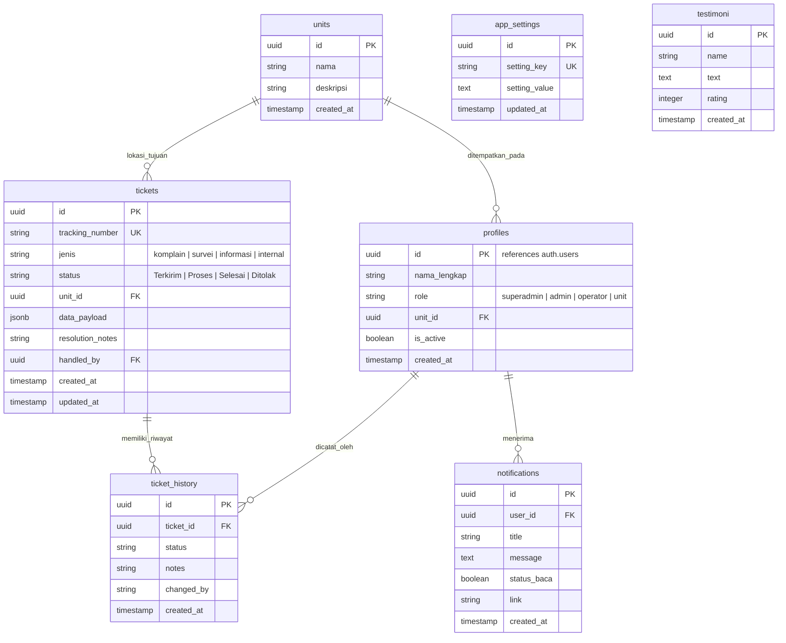
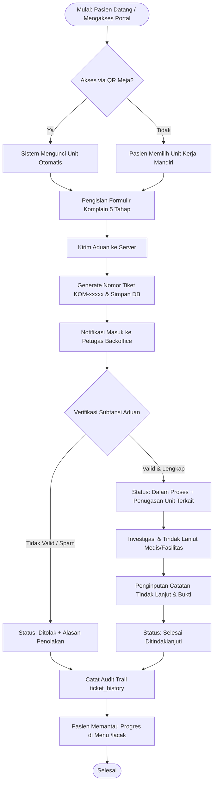
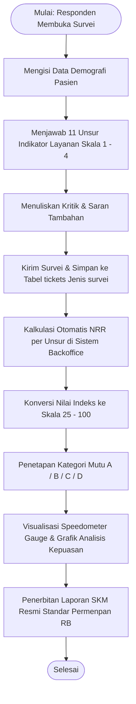

# DOKUMENTASI LENGKAP APLIKASI
## PUAS (Kanal Aduan, Survey, dan Informasi Terintegrasi)
### Rumah Sakit Umum Daerah Bendan / Unit Pelayanan Publik

---

## DAFTAR ISI
1. [Tentang Sistem & Landasan Kebijakan](#1-tentang-sistem--landasan-kebijakan)
2. [Arsitektur & Tumpukan Teknologi (Tech Stack)](#2-arsitektur--tumpukan-teknologi-tech-stack)
3. [Skema & Struktur Basis Data](#3-skema--struktur-basis-data)
4. [Modul Layanan Publik (Frontend Pasien & Masyarakat)](#4-modul-layanan-publik-frontend-pasien--masyarakat)
   - [4.1 Beranda Terpadu (`/`)](#41-beranda-terpadu-)
   - [4.2 Survei Kepuasan Masyarakat (`/survei`)](#42-survei-kepuasan-masyarakat-survei)
   - [4.3 Formulir Komplain & Pengaduan (`/komplain`)](#43-formulir-komplain--pengaduan-komplain)
   - [4.4 Formulir Permintaan Informasi Publik (`/informasi`)](#44-formulir-permintaan-informasi-publik-informasi)
   - [4.5 Pengaduan Whistleblowing Internal (`/aduan-internal`)](#45-pengaduan-whistleblowing-internal-aduan-internal)
   - [4.6 Lacak Status Tiket Mandiri (`/lacak`)](#46-lacak-status-tiket-mandiri-lacak)
5. [Modul Backoffice Administrator (`/admin`)](#5-modul-backoffice-administrator-admin)
   - [5.1 Otentikasi & Keamanan Sesi (`/login`)](#51-otentikasi--keamanan-sesi-login)
   - [5.2 Dashboard Utama Eksekutif (`/admin`)](#52-dashboard-utama-eksekutif-admin)
   - [5.3 Manajemen Tiket Pelayanan (`/admin/tiket`)](#53-manajemen-tiket-pelayanan-admintiket)
   - [5.4 Analisa & Tren Laporan (`/admin/analisa`)](#54-analisa--tren-laporan-adminanalisa)
   - [5.5 Analisis Kepuasan & Speedometer IKM (`/admin/analisis-kepuasan`)](#55-analisis-kepuasan--speedometer-ikm-adminanalisis-kepuasan)
   - [5.6 Rekapitulasi Laporan Global (`/admin/laporan`)](#56-rekapitulasi-laporan-global-adminlaporan)
   - [5.7 Master Data Unit Kerja & Batch Impor Excel (`/admin/unit`)](#57-master-data-unit-kerja--batch-impor-excel-adminunit)
   - [5.8 Master QR Code Unit & Kartu Display Meja (`/admin/qrcode`)](#58-master-qr-code-unit--kartu-display-meja-adminqrcode)
   - [5.9 Manajemen Pengguna & Hak Akses (`/admin/pengguna`)](#59-manajemen-pengguna--hak-akses-adminpengguna)
   - [5.10 Pengaturan Sistem & Generator Dokumen Teknis (`/admin/pengaturan`)](#510-pengaturan-sistem--generator-dokumen-teknis-adminpengaturan)
6. [Diagram Alir Bisnis (Flowchart Standar ANSI/ISO)](#6-diagram-alir-bisnis-flowchart-standar-ansiiso)
7. [Formulasi Matematis Indeks Kepuasan Masyarakat (IKM)](#7-formulasi-matematis-indeks-kepuasan-masyarakat-ikm)
8. [Panduan Instalasi, Konfigurasi, dan Pemeliharaan](#8-panduan-instalasi-konfigurasi-dan-pemeliharaan)

---

## 1. Tentang Sistem & Landasan Kebijakan

### 1.1 Deskripsi Umum
**PUAS** (*Platform Pelayanan Terpadu untuk Pengaduan, Survei Kepuasan, dan Keterbukaan Informasi*) adalah sistem informasi berbasis web responsif modern yang dirancang untuk mendukung transformasi digital layanan publik di lingkungan rumah sakit dan fasilitas kesehatan. Sistem ini menghubungkan pasien, pengunjung, pegawai, dan manajemen rumah sakit ke dalam satu ekosistem terpadu secara *real-time*.

### 1.2 Landasan Hukum & Regulasi
Penyusunan arsitektur logika dan indikator operasional pada aplikasi PUAS merujuk pada:
1. **Undang-Undang Nomor 25 Tahun 2009 tentang Pelayanan Publik**: Kewajiban instansi penyelenggara pelayanan untuk menyediakan sarana pengaduan, evaluasi mutu, dan mekanisme pertanggungjawaban.
2. **Undang-Undang Nomor 14 Tahun 2008 tentang Keterbukaan Informasi Publik (KIP)**: Hak masyarakat atas akses informasi layanan publik serta tata cara Permintaan Informasi Resmi.
3. **Peraturan Menteri PAN-RB Nomor 14 Tahun 2017**: Pedoman Penyusunan Survei Kepuasan Masyarakat (SKM) Unit Penyelenggara Pelayanan Publik (11 unsur indikator pelayanan dan rumus konversi IKM skala 25–100).
4. **Permenkes tentang Tata Kelola Rumah Sakit & Keselamatan Pasien**: Penanganan keluhan dan penegakan budaya mutu pelayanan berkelanjutan (*Continuous Quality Improvement*).

---

## 2. Arsitektur & Tumpukan Teknologi (Tech Stack)

Sistem PUAS dibangun menggunakan arsitektur modern berbasis jamstack / fullstack Next.js:

```
+-------------------------------------------------------------------------------+
|                           KLIEN (Browser / Smartphone)                        |
|   - Akses Langsung (Web Portal)                                               |
|   - Akses via QR Code Meja/Poli (?unitId=...&lockUnit=true)                   |
+-------------------------------------------------------------------------------+
                                      |
                                      v
+-------------------------------------------------------------------------------+
|                      FRONTEND LAYER (Next.js 16 App Router)                   |
|   - React 19, TypeScript, Tailwind CSS v4, Framer Motion                      |
|   - Lucide React (Vector Iconography), Recharts (Interactive Charts)          |
|   - Client & Server Form Validation (Zod, React Hook Form)                    |
+-------------------------------------------------------------------------------+
                                      |
                                      v
+-------------------------------------------------------------------------------+
|                      MIDDLEWARE & SESSION MANAGEMENT                          |
|   - Inactivity Timeout Controller (Auto Sign-out 30 menit)                    |
|   - Remember Me Feature (Stay Signed-in 30 hari via Cookie Refresh)           |
|   - Route Protection Guard (/admin/*)                                         |
+-------------------------------------------------------------------------------+
                                      |
                                      v
+-------------------------------------------------------------------------------+
|                      BACKEND & DATABASE LAYER (Supabase)                      |
|   - Supabase SSR Auth (JWT Token, Secure HttpOnly Cookie)                     |
|   - PostgreSQL Database Engine                                                |
|   - Row-Level Security (RLS) & Granular Access Control                        |
|   - Supabase Realtime Channels (Live Notifications)                           |
+-------------------------------------------------------------------------------+
                                      |
                                      v
+-------------------------------------------------------------------------------+
|                      EKSPOR DOKUMEN & INTEGRASI LAPORAN                       |
|   - jsPDF & jsPDF-AutoTable (Laporan Formal ber-Cover Page & Vektor Grafik)   |
|   - XLSX / SheetJS (Ekspor & Batch Impor Excel Data Unit)                     |
|   - QRCode Engine (Generator QR Unit & Kartu Display Akrilik Meja)            |
+-------------------------------------------------------------------------------+
```

### Rincian Dependensi Utama:
- **Framework Core**: `next` (v16.2.3), `react` (v19.2.4), `react-dom` (v19.2.4), `typescript` (v5.x).
- **Styling & UI**: `@tailwindcss/postcss` (v4), `clsx`, `tailwind-merge`, `framer-motion` (v12.x), `lucide-react`.
- **Database & Auth**: `@supabase/ssr` (v0.10.x), `@supabase/supabase-js` (v2.103.x).
- **Validasi**: `zod` (v4.x), `@hookform/resolvers`, `react-hook-form`.
- **Ekspor Dokumen**: `jspdf`, `jspdf-autotable`, `xlsx`, `qrcode`, `html2canvas`.

---

## 3. Skema & Struktur Basis Data

### 3.1 Diagram Hubungan Entitas (Entity-Relationship)



### 3.2 Penjelasan Struktur Tabel

1. **`tickets`**:
   - `id`: Identifier unik (UUID).
   - `tracking_number`: Kode pelacakan unik publik (contoh: `KOM-12345`, `SRV-54321`, `INF-98765`, `INT-11223`).
   - `jenis`: Kategori layanan (`komplain`, `survei`, `informasi`, `internal`).
   - `status`: Siklus hidup tiket (`Terkirim`, `Proses`, `Selesai`, `Ditolak`).
   - `unit_id`: Relasi ke tabel `units` untuk unit kerja atau poli yang dituju.
   - `data_payload`: Struktur JSONB fleksibel yang menyimpan seluruh isian formulir:
     - Komplain: `{ nama, noRM, noHP, hubungan, tglKejadian, jamKejadian, unitLokasi, kategoriKeluhan, uraianKeluhan, harapan, lampiranUrl }`
     - Survei: `{ nama, hp, alamat, umur, gender, pendidikan, pekerjaan, ratings: { q1..q11 }, feedback }`
     - Informasi: `{ nama, noIdentitas, kategoriPemohon, alamat, noWA, email, topikInformasi, tujuan, uraianDetail, caraMemperoleh, metodePengiriman }`
     - Internal: `{ namaPelapor, unitAsal, jenisPelanggaran, terduga, tanggal, kronologi, lampiranUrl }`
   - `resolution_notes`: Catatan resolusi akhir dari petugas.
   - `handled_by`: UUID staf yang menangani tiket.

2. **`ticket_history`**:
   - Mencatat setiap pergeseran status tiket secara kronologis (Audit Trail).
   - Memastikan transparansi saat pasien melacak tiket melalui menu `/lacak`.

3. **`units`**:
   - Master data unit kerja, instalasi, dan poli rawat jalan/inap.
   - Mendukung integrasi dengan generator Master QR Code dan modul filter laporan.

4. **`profiles`**:
   - Menyimpan profil pegawai dan otorisasi hak akses (Role-Based Access Control).
   - `superadmin`: Akses penuh ke seluruh menu dan pengaturan sistem.
   - `admin`: Pengelolaan operasional tiket, unit, analisa, dan pelaporan.
   - `operator`: Penanganan tiket dan pembaruan tindak lanjut.
   - `unit`: Dibatasi hanya untuk melihat dan menindaklanjuti tiket pada unit kerjanya sendiri.

5. **`app_settings`**:
   - Konfigurasi global dinamis instansi: `app_name`, `app_logo`, `nama_instansi`, `nama_sub_instansi`, `alamat`, `email`, `whatsapp_kontak`, dan parameter IKM.

---

## 4. Modul Layanan Publik (Frontend Pasien & Masyarakat)

### 4.1 Beranda Terpadu (`/`)
- **Header Dinamis**: Menampilkan logo rumah sakit, ucapan selamat datang kontekstual (*Pagi/Siang/Sore/Malam*), dan nama resmi instansi.
- **Bar Jadwal Sholat**: Widget waktu sholat real-time otomatis berdasarkan koordinat lokal fasilitas pelayanan.
- **Menu Utama Layanan**: 6 tombol pintasan dengan ikon vektor modern dan fitur Text-to-Speech (audio feedback):
  - Survei Kepuasan Masyarakat
  - Komplain Pasien
  - Lacak Status Tiket
  - Permintaan Informasi Publik
  - Aduan Internal RS
  - Kontak CS (Direct WhatsApp)
- **Deteksi Akses QR Code**: Jika halaman diakses melalui pemindaian QR Code meja/ruangan (`?unitId=...&lockUnit=true`), beranda menampilkan banner hijau informatif: *"📍 Unit Layanan Terpilih (Akses QR Code): [Nama Unit] - Terkunci Otomatis"*, dan seluruh tautan menu secara otomatis mewariskan filter unit tersebut.
- **Accordion FAQ**: 5 daftar pertanyaan umum yang paling sering diajukan masyarakat.
- **Testimoni Marquee**: Slider interaktif berisi ulasan pasien dan tombol input ulasan baru secara mandiri.

---

### 4.2 Survei Kepuasan Masyarakat (`/survei`)
- **Standar Permenpan RB No. 14 Tahun 2017**:
  Mengukur 11 Unsur Pelayanan Publik:
  1. `U1` - Kesesuaian Persyaratan Pelayanan
  2. `U2` - Kemudahan Sistem, Mekanisme, dan Prosedur
  3. `U3` - Kecepatan Waktu Pelayanan
  4. `U4` - Kewajaran Biaya / Tarif
  5. `U5` - Kesesuaian Produk Layanan
  6. `U6` - Kompetensi / Kemampuan Petugas
  7. `U7` - Perilaku, Kesopanan, dan Keramahan Petugas
  8. `U8` - Kualitas Sarana dan Prasarana
  9. `U9` - Penanganan Pengaduan dan Respon
  10. `U10` - Kepastian dan Garansi Layanan
  11. `U11` - Integritas dan Pencegahan Pungli/Suap
- **Formulir Bertahap (Stepper)**:
  - **Tahap 1 (Demografi Responden)**: Umur, Jenis Kelamin, Pendidikan Terakhir, Pekerjaan, Unit Pelayanan yang dinilai.
  - **Tahap 2 (Kuesioner 11 Indikator)**: Pilihan visual 4 skala emotikon mutu (*Tidak Baik [1], Kurang Baik [2], Baik [3], Sangat Baik [4]*).
  - **Tahap 3 (Saran & Konfirmasi)**: Isian saran konstruktif dan pernyataan validitas.
- **Fitur Kunci**: Proteksi kunci unit kerja otomatis apabila survei dibuka dari pemindaian QR Code meja loket.

---

### 4.3 Formulir Komplain & Pengaduan (`/komplain`)
- **Tahapan Input**:
  - **Tahap 1 (Identitas Pelapor)**: Nama lengkap, Nomor Rekam Medis (opsional), Nomor WhatsApp, Hubungan Pelapor (*Pasien Sendiri, Keluarga, Kuasa Pasien*).
  - **Tahap 2 (Lokasi & Waktu Kejadian)**: Pemilihan tanggal kejadian, jam kejadian, dan dropdown unit/ruangan yang dikeluhkan (dengan proteksi *lock unit* via QR Code).
  - **Tahap 3 (Kategori Keluhan)**: 6 Kategori terstandar (*Komunikasi & Perilaku, Kualitas Layanan Medis, Waktu Tunggu, Fasilitas & Kebersihan, Biaya & Administrasi, Keamanan*).
  - **Tahap 4 (Uraian Kejadian)**: Penjelasan kronologi kejadian secara detail minimal 15 karakter dan tautan dokumen pendukung/foto bukti.
  - **Tahap 5 (Harapan Pelapor)**: Pilihan harapan solusi (*Permohonan maaf, perbaikan segera, penjelasan medis, kompensasi/koreksi biaya, dsb.*).
- **Output**: Pasien memperoleh nomor tiket registrasi unik format `KOM-xxxxx` lengkap dengan tombol cetak bukti dan salin nomor tiket.

---

### 4.4 Formulir Permintaan Informasi Publik (`/informasi`)
- Disesuaikan dengan standar **Formulir Permintaan Informasi Rumah Sakit (FPI-RS)** UU KIP.
- Tahap pengisian: Identitas Pemohon, Kategori Pemohon (*Perorangan, Lembaga, Mahasiswa*), Judul/Topik Informasi, Unit Dituju (terkunci jika via QR), Tujuan Penggunaan, Cara Memperoleh (*Melihat langsung, hardcopy, softcopy PDF*), dan Metode Pengiriman (*Email, WhatsApp, Diambil Langsung*).
- **Nomor Registrasi**: `INF-xxxxx` dengan SLA tindak lanjut maksimal $1 \times 24$ jam kerja.

---

### 4.5 Pengaduan Whistleblowing Internal (`/aduan-internal`)
- Kanal tertutup khusus bagi tenaga medis dan staf internal rumah sakit untuk melaporkan potensi pelanggaran disiplin, fraud, atau keselamatan kerja.
- Dilengkapi opsi **Kerahasiaan Identitas / Pelapor Anonim** untuk melindungi pelapor (*Whistleblower Protection*).
- **Nomor Registrasi**: `INT-xxxxx`.

---

### 4.6 Lacak Status Tiket Mandiri (`/lacak`)
- Masyarakat dapat memantau penanganan aduan cukup dengan memasukkan nomor tiket.
- **Visualisasi Stepper Progres**:
  - `Terkirim` (Abu-abu / Biru muda)
  - `Dalam Proses` (Oranye cerah)
  - `Selesai Ditindaklanjuti` (Hijau) atau `Ditolak` (Merah).
- **Log Riwayat Penanganan**: Menampilkan timeline setiap tanggal, jam, petugas penanggung jawab, dan catatan resmi penanganan keluhan.

---

## 5. Modul Backoffice Administrator (`/admin`)

### 5.1 Otentikasi & Keamanan Sesi (`/login`)
- **Login Keamanan Tinggi**: Autentikasi berbasis Supabase SSR Auth.
- **Fitur View/Hide Password**: Tombol ikon mata untuk melihat dan menyembunyikan input kata sandi.
- **Manajemen Sesi Cerdas**:
  - **Mode Reguler (Default)**: Otomatis *Sign-out* jika tidak ada aktivitas selama 30 menit demi keamanan data pasien di komputer kerja bersama.
  - **Mode "Ingat Saya / Tetap Masuk" (Stay Signed-in)**: Menjaga sesi aktif hingga 30 hari tanpa terlempar keluar selama pengguna tidak menekan tombol *Keluar (Sign Out)* manual.

---

### 5.2 Dashboard Utama Eksekutif (`/admin`)
- **Ringkasan KPI Card**:
  - Total Tiket Masuk
  - Tiket Menunggu Verifikasi
  - Tiket Sedang Diproses
  - Tiket Berhasil Diselesaikan & Persentase Tingkat Resolusi
- **Grafik Tren Volume**: Grafik area/garis Recharts yang menampilkan pergerakan komplain harian dan bulanan.
- **Pemberitahuan Real-time**: Dropdown notifikasi tiket masuk baru dengan penanda baca.

---

### 5.3 Manajemen Tiket Pelayanan (`/admin/tiket`)
- **Filter Multi-Kriteria**:
  - **Filter Unit Kerja**: Menyaring tiket berdasarkan poli/unit tertentu atau melihat keseluruhan unit.
  - **Filter Status**: `Semua`, `Terkirim`, `Proses`, `Selesai`, `Ditolak`.
  - **Filter Jenis Layanan**: `Semua`, `Komplain`, `Survei`, `Informasi`, `Internal`.
  - **Pencarian Bebas**: Mencari berdasarkan nomor tiket, nama pasien/pelapor, atau kata kunci keluhan.
- **Modal Tindak Lanjut Tiket**:
  - Menampilkan data lengkap pelapor, waktu kejadian, kategori, dan detail kronologi.
  - Pembaruan status tiket ke `Proses`, `Selesai`, atau `Ditolak`.
  - Form isian Catatan Tindak Lanjut (*Resolution Notes*) yang otomatis tercatat ke tabel `ticket_history`.
- **Ekspor Dokumen Laporan Resmi**:
  - **Format PDF Resmi**: Dilengkapi **Halaman Sampul (Cover Page)** resmi, nomor register dokumen, ringkasan KPI, grafik batang status tiket, narasi evaluasi berbahasa formal, tabel data lengkap tiket, dan kolom tanda tangan pengesahan pimpinan.
  - **Format Excel (.xlsx)**: File spreadsheet rapi dengan data atribut lengkap siap olah.

---

### 5.4 Analisa & Tren Laporan (`/admin/analisa`)
- **Visualisasi Dinamis**:
  - **Tren Volume Pelaporan**: Grafik garis komparasi pergerakan pelaporan antar-bulan.
  - **Rasio Kategori Laporan**: Frame lebar yang menampilkan distribusi proporsi keluhan berdasarkan kategori layanan (*Kualitas Medis, Fasilitas, Waktu Tunggu, dsb.*).
  - **Komparasi Kinerja Bulanan**: Tabel selisih kenaikan/penurunan keluhan.
- **Ekspor Laporan Analisis**: Dilengkapi cover resmi, grafik vektor kategori, analisis naratif performa, dan lembar disposisi manajerial.

---

### 5.5 Analisis Kepuasan & Speedometer IKM (`/admin/analisis-kepuasan`)
- **Demografi Responden**: Distribusi responden berdasarkan usia, jenis kelamin, tingkat pendidikan, dan pekerjaan.
- **Kartu Indeks Kepuasan Masyarakat (IKM)**:
  - **Skor IKM Global**: Nilai konversi indeks skala 25.00–100.00.
  - **Predikat Mutu Layanan**: Nilai A (Sangat Baik), B (Baik), C (Kurang Baik), atau D (Tidak Baik).
  - **Tingkat Resolusi Pelayanan**: Persentase aduan terselesaikan.
- **Grid Speedometer Gauge 11 Indikator Lengkap**:
  - Mengukur seluruh unsur $U_1$ s.d. $U_{11}$ Permenpan RB.
  - Desain *Speedometer Gauge SVG* stylish dengan jarum berputar presisi, nilai konversi, dan label mutu pelayanan.
- **Ekspor Laporan Standar Permenpan RB**:
  - PDF komprehensif ber-cover dengan grafik bar konversi 11 unsur, tabel statistik, analisis kualitatif, dan lembar legalitas.

---

### 5.6 Rekapitulasi Laporan Global (`/admin/laporan`)
- **Posisi Frame Ergonomis**:
  - Frame **Ranking Unit Kerja Terbanyak Dikeluhkan** diposisikan di atas frame **Sebaran Kategori Layanan** untuk memudahkan identifikasi unit prioritas evaluasi.
- **Filter Rentang Waktu**: Pemilihan periode pelaporan harian, mingguan, bulanan, atau tahunan.
- **Ekspor Laporan**: Tombol ekspor PDF dan Excel dengan ukuran stylish dan tidak terjadi overflow teks.

---

### 5.7 Master Data Unit Kerja & Batch Impor Excel (`/admin/unit`)
- **Tabel Master Unit**: Pengelolaan daftar unit kerja, instalasi, poliklinik, dan ruangan rawat inap.
- **Unduh Template Excel**: Menghasilkan file `Template_Import_Unit_Kerja.xlsx` dengan format header standar:
  - Kolom A: `Nama Unit / Ruangan` (Wajib diisi)
  - Kolom B: `Deskripsi / Lokasi` (Opsional)
- **Impor Data Excel**:
  - Modal unggah file `.xlsx` / `.csv`.
  - Pembacaan data lokal instan via SheetJS.
  - Validasi baris kosong dan duplikasi nama unit.
  - Pratinjau (*Live Preview*) data sebelum disimpan ke database.
  - *Batch Insert* ke tabel Supabase `units` dalam satu kali klik.

---

### 5.8 Master QR Code Unit & Kartu Display Meja (`/admin/qrcode`)
- **Pusat Pembuatan QR Code**:
  - Menghasilkan QR Code unik untuk setiap unit kerja yang terdaftar di database.
- **4 Pilihan Mode URL QR Code**:
  1. `Gabungan`: Mengarah ke beranda utama dengan unit terkunci (`/?unitId=[id]&lockUnit=true`).
  2. `Survei Kepuasan`: Mengarah langsung ke kuesioner IKM unit (`/survei?unitId=[id]&lockUnit=true`).
  3. `Komplain Pasien`: Mengarah langsung ke formulir pengaduan unit (`/komplain?unitId=[id]&lockUnit=true`).
  4. `Permintaan Informasi`: Mengarah ke formulir FPI unit (`/informasi?unitId=[id]&lockUnit=true`).
- **Fitur Ekspor**:
  - **Unduh PNG**: Berkas gambar QR Code tajam beresolusi tinggi untuk dicetak manual atau dipasang di media promosi.
  - **Cetak Stand Meja (PDF)**: Format dokumen kartu akrilik meja ukuran standar loket (lengkap dengan kop instansi, nama unit jelas, instruksi pemindaian, dan QR Code terpusat) siap cetak.
- **Mekanisme Lock Unit**: Menjamin pasien yang memindai QR Code di loket poli fisik tidak dapat memanipulasi atau salah memilih unit lain.

---

### 5.9 Manajemen Pengguna & Hak Akses (`/admin/pengguna`)
- Mengatur data seluruh operator dan pimpinan.
- Penugasan peran: `Superadmin`, `Admin`, `Operator`, `Unit`.
- Penonaktifan akun instan (*Toggle Active/Inactive*) jika pegawai mutasi atau tidak lagi bertugas.

---

### 5.10 Pengaturan Sistem & Generator Dokumen Teknis (`/admin/pengaturan`)
- **Tab Identitas Instansi**: Pengaturan logo instansi, nama rumah sakit, alamat fisik, nomor hotline WhatsApp, dan email resmi.
- **Tab Backup & Pemulihan**: Ekspor cadangan basis data format JSON dan Excel.
- **Tab Dokumentasi & Buku Pedoman Sistem**:
  - Menghasilkan **Dokumen Buku Pedoman Teknis & Standar Operasional Prosedur (SOP) Sistem PUAS** dalam format PDF resmi 6 halaman.
  - Memuat **Flowchart ANSI/ISO resmi**, arsitektur 9 modul sistem, formula matematis IKM, dan lembar legalisasi.

---

## 6. Diagram Alir Bisnis (Flowchart Standar ANSI/ISO)

### 6.1 Alur Pelayanan Pengaduan & Tindak Lanjut Komplain



### 6.2 Alur Survei Kepuasan & Pengolahan Skor IKM



---

## 7. Formulasi Matematis Indeks Kepuasan Masyarakat (IKM)

Berdasarkan ketentuan **Permenpan RB Nomor 14 Tahun 2017**, perhitungan survei kepuasan dihitung melalui tahapan sebagai berikut:

### 7.1 Nilai Rata-Rata (NRR) per Unsur
$$\text{NRR}_j = \frac{\sum_{i=1}^{N} \text{Skor}_{i,j}}{N}$$
*Keterangan:*
- $\text{NRR}_j$ : Nilai Rata-Rata unsur ke-$j$ ($j = 1, 2, \dots, 11$).
- $N$ : Jumlah seluruh responden survei yang masuk.

### 7.2 Nilai Rata-Rata Tertimbang
Bobot nilai setiap unsur adalah berimbang:
$$\text{Bobot} = \frac{1}{\text{Jumlah Unsur}} = \frac{1}{11} \approx 0.0909$$

$$\text{IKM Tertimbang} = \sum_{j=1}^{11} \left( \text{NRR}_j \times \frac{1}{11} \right)$$

### 7.3 Nilai Konversi IKM (Skala 25 – 100)
$$\text{Nilai Konversi IKM} = \text{IKM Tertimbang} \times 25$$

### 7.4 Tabel Konversi Mutu Pelayanan

| Nilai Persepsi | Nilai Interval IKM | Nilai Konversi IKM | Mutu Pelayanan | Kinerja Pelayanan |
| :---: | :---: | :---: | :---: | :---: |
| **1** | $1.00 - 2.5996$ | $25.00 - 64.99$ | **D** | Tidak Baik |
| **2** | $2.60 - 3.0640$ | $65.00 - 76.60$ | **C** | Kurang Baik |
| **3** | $3.0644 - 3.5320$ | $76.61 - 88.30$ | **B** | Baik |
| **4** | $3.5324 - 4.0000$ | $88.31 - 100.00$ | **A** | Sangat Baik |

---

## 8. Panduan Instalasi, Konfigurasi, dan Pemeliharaan

### 8.1 Prasyarat Sistem
- **Node.js**: Versi `18.18.0` atau yang lebih baru (disarankan Node.js 20 LTS).
- **Package Manager**: `npm` (v10+), `yarn`, atau `pnpm`.
- **Database**: Akun proyek Supabase (PostgreSQL 15+).

### 8.2 Konfigurasi Environment Variables
Buat berkas `.env.local` pada direktori *root* aplikasi:

```env
NEXT_PUBLIC_SUPABASE_URL=https://[PROJECT_ID].supabase.co
NEXT_PUBLIC_SUPABASE_ANON_KEY=eyJhbGciOiJIUzI1NiIsInR5cCI6IkpXVCJ9...
```

### 8.3 Langkah Instalasi & Menjalankan Aplikasi
1. **Clone atau Buka Direktori Proyek**:
   ```bash
   cd "d:/Aplikasi Antigravity/PUAS"
   ```
2. **Instal Seluruh Dependensi**:
   ```bash
   npm install
   ```
3. **Jalankan Server Pengembangan (Dev Server)**:
   ```bash
   npm run dev
   ```
   Aplikasi dapat diakses melalui browser pada `http://localhost:3000`.
4. **Kompilasi Versi Produksi (Production Build)**:
   ```bash
   npm run build
   ```
5. **Jalankan Server Produksi**:
   ```bash
   npm start
   ```

### 8.4 Akun Akses Default Administrator
- **URL Akses**: `http://localhost:3000/login`
- Masukkan kredensial administrator yang telah didaftarkan pada Supabase Auth (`profiles`).
- Pastikan mencentang **"Tetap Masuk (Stay Signed In)"** apabila menggunakan perangkat kantor pribadi.

---
*Dokumentasi ini disusun sebagai standar operasional dan referensi teknis pengembang serta pengelola sistem PUAS RSUD Bendan.*

